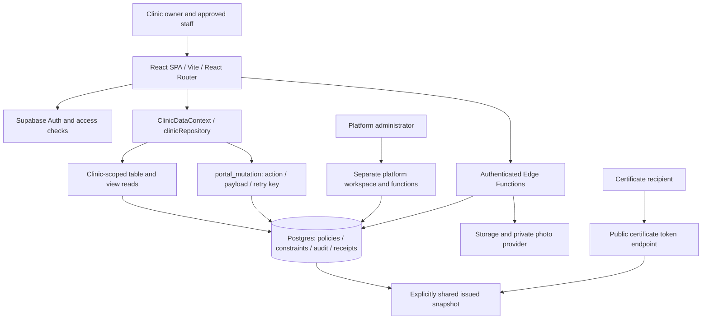

# Veterina — Product Requirements and Upgrade Plan

| Document field | Value |
| --- | --- |
| Version | 2.0 |
| Updated | 8 November 2026 |
| Scope | Whole system: clinic workspace, public documents, platform administration, backend, and future upgrades |
| Status | Current implementation baseline with a proposed roadmap |
| Audience | Clinic owner, clinical staff, product owner, developers, and release reviewers |
| Evidence | Current local source, including uncommitted work, migrations, test suites, README, and TESTING.md |
| Verification boundary | Repository review only. No hosted database, production deployment, or new test execution was used to certify this baseline. |

## 1. Purpose and document authority

Veterina connects patient registration, arrivals, clinical care, preventive care, prescriptions, scheduling, inventory, and documents. It supports separate clinics, staff approval, personalization, and subscription access managed by a separate platform administrator.

This PRD establishes what currently exists, the behavior upgrades must preserve, and the next work to prioritize. It replaces the previous backend-only plan, which described an in-memory, single-clinic prototype and treated persistence and access as future scope. That description no longer represents the source.

Use this document as the whole-system planning baseline. [PRD.frontend.md](PRD.frontend.md) and [Veterina-Backend-PRD.md](Veterina-Backend-PRD.md) remain historical design references; their prototype assumptions, sprint plans, and statuses are not current delivery commitments. Legacy `FR-*`, `BR-*`, `RR-*`, and `OD-*` identifiers are not reused here. Review existing issues against this baseline before carrying them forward.

| Status | Meaning |
| --- | --- |
| Implemented | User flow and supporting code exist locally; this does not establish deployment or production readiness. |
| Configuration dependent | Implementation needs matching migrations, providers, secrets, or scheduled workers on the target. |
| Paused | Code remains but is not exposed as an active workspace feature. |
| Proposed | Recommended future work, not a delivery commitment or completed feature. |
| Needs verification | Available evidence does not establish an operational guarantee. |

Dates, estimates, budgets, and staffing for upgrades require agreement after baseline verification. Test coverage below means tests exist. Prior results in TESTING.md are historical evidence, not fresh results for this review.

## 2. Product direction and scope

### 2.1 Problem and intended outcome

Staff need dependable patient history and a clear view of today's work. Disconnected notes, arrivals, reminders, prescriptions, and stock changes create duplicate entry and reconciliation work. Clinic owners need control over staff, documents, exports, and settings.

The connected journey is:

**Register patient → record arrival or appointment → deliver care → save evidence → dispense or administer stock → complete care → follow up and retrieve history.**

Past care must also be recordable without becoming today's operational work. Platform subscription administration must not automatically grant patient access.

### 2.2 Goals

| ID | Goal | Success evidence |
| --- | --- | --- |
| GOAL-01 | Complete, accessible patient history | Staff find source visits, preventive items, prescriptions, corrections, and documents. |
| GOAL-02 | Actionable daily work | Staff identify waiting/in-progress care, eligible arrivals, due calls, and stock attention. |
| GOAL-03 | Clinical and stock integrity | Retries/concurrency cause no duplicate completion, repeated dispensing, negative balance, or partial transaction. |
| GOAL-04 | Isolated, attributable access | Anonymous, unapproved, inactive, expired, and other-clinic requests cannot perform prohibited operations. |
| GOAL-05 | Durable clinic documents | Reprints retain issued evidence after source records change. |
| GOAL-06 | Repeatable releases and recovery | Matching versions, acceptance evidence, and recovery procedures accompany releases. |
| GOAL-07 | Usable daily workflows | Mobile, keyboard, and appearance support preserve clinical safeguards. |

### 2.3 Scope boundaries

Included: clinic/staff onboarding, patient/owner records, queues, checkups, services, vaccinations/deworming, prescriptions, appointments/reminders, stock/suppliers, reports, travel certificates, settings, subscriptions, and the installable web app.

Separate discovery is required for billing/POS/accounting, payments, pet-owner accounts/booking portals, automated SMS/email/WhatsApp outreach, laboratory/imaging integrations, general clinical attachments, cross-clinic sharing, offline clinical editing, autonomous diagnosis/dosing, and AI write actions. Authentication emails and public certificate links do not constitute a portal or automated reminder service.

## 3. Users, roles, and access

“Clinic owner” means an account role. “Pet owner” means a patient contact record and does not grant an account. Platform administrator is a separately provisioned capability.

| Persona | Current capability and boundary |
| --- | --- |
| Clinic owner | Approved clinical access; settings, veterinarian details, services, branding, staff approval, owner-only exports, corrections, and permitted deletion/administration. |
| Clinical staff | Approved care, arrivals, queue, appointments, reminders, prescriptions, stock workflows, and personal appearance. Owner-only actions remain restricted. |
| Platform administrator | Separate `/admin` subscription/code/extension/event workspace. Platform status alone does not grant clinical membership. |
| Pending/inactive staff | Account/access-status flows; no approved clinic workspace. |
| Expired clinic member | Subscription recovery flow; normal workspace gated. Verify hosted API and public-document behavior per release. |
| Anonymous visitor | Landing/account entry and explicitly public certificate viewing with a valid token. No clinic browsing. |
| Pet owner / recipient | Receives documents or a deliberately public link. No patient portal exists. |

Current access model:

- Owners register, redeem a subscription activation code to establish their clinic, and complete personalization.
- Staff register with the clinic's **Veterina Code**, complete required account verification, and await owner approval. Join and subscription codes serve separate purposes.
- Email/password, recovery, and configured Google authentication have implementation paths; target Auth/email/provider setup determines availability.
- Active `profiles` membership, identity, clinic state, and subscription state govern access. Database policies and server checks enforce clinic boundaries.
- Registration is not universally invite-only or MFA-enforced. Invitations/hosted MFA need separate acceptance; mandatory MFA remains a decision.

Evidence: [routes](src/App.jsx), [workspace gate](src/components/ProtectedWorkspace.jsx), [access rules](src/lib/authAccess.js), [AuthContext](src/context/AuthContext.jsx), [access design](docs/veterina-code-rbac-plan.md).

## 4. Current system baseline

### 4.1 Routes

| Area | Routes | Status |
| --- | --- | --- |
| Public/accounts | `/`, `/sign-in`, `/create-account`, `/forgot-password`, `/reset-password` | Implemented; providers configuration dependent |
| Access completion | `/complete-account`, `/access-pending`, `/subscription` | Implemented |
| Daily work | `/dashboard`, `/queue` | Implemented |
| Patients | `/patients`, `/patients/:petId` | Implemented |
| Hospitalization | `/admissions`, `/admissions/:admissionId` | Implemented locally; matching migrations required |
| Scheduling/tasks | `/appointments`; `/reminders` redirects to its task view | Implemented |
| Stock | `/inventory`, `/suppliers` | Implemented |
| Documents | `/travel-certificates`, public `/travel-certificate` | Implemented; public serving needs matching function |
| Clinic administration | `/reports`, `/settings`; `/clinic-setup` redirects to settings | Implemented; action/role permissions apply |
| Platform | `/admin/sign-in`, `/admin` | Implemented; role provisioned separately |
| Legacy entry | `/login`, `/demo` | Compatibility routes, not a separate demo-data workspace |
| Knowledge | `/knowledge` route commented out | Paused |

### 4.2 Feature requirements already implemented

These IDs describe current behavior that upgrades must preserve. Configuration/device qualifications are called out explicitly.

| ID | Capability | Evidence |
| --- | --- | --- |
| SYS-01 | Saved backend records and genuine empty states, without fixture fallbacks. | [context](src/context/ClinicDataContext.jsx), [repository](src/lib/clinicRepository.js) |
| SYS-02 | Dashboard action board for active care, eligible arrivals, calls, and stock attention, with source links and visible-page refresh. | [Dashboard](src/pages/Dashboard.jsx), [workflow specification](DAILY-WORKFLOW-PLAN.md) |
| SYS-03 | Owner/patient search and registration, walk-in arrival, contacts, identifiers, alerts, diet/environment, baseline details, optional private photos. | [Patients](src/pages/Patients.jsx), [walk-in](src/components/WalkInRegistration.jsx), [editors](src/components/PatientEditors.jsx) |
| SYS-04 | Numbered queues, assigned veterinarian/staff, Waiting/In progress/Completed/Cancelled states, resumable drafts and version-conflict feedback. | [Queue](src/pages/Queue.jsx), [queue editors](src/components/QueueEditors.jsx) |
| SYS-05 | Add Record in one modal: service → recording method → detail steps → review → final save. Back/visited steps retain input; review permits edits. Existing queue editors remain direct entry points. | [NewVisitDialog](src/components/NewVisitDialog.jsx), [RecordWizard](src/components/RecordWizard.jsx), [RecordForm](src/components/RecordForm.jsx) |
| SYS-06 | Checkups include visit details, vitals, notes, diagnosis and follow-up. History, Clinical Assessment, and Treatment Plan labels retain legacy storage/assessment content. Completion, prescribing, finalization and corrections have distinct rules. | [clinical editors](src/components/ClinicalEditors.jsx), [observations](src/lib/clinicalObservations.js) |
| SYS-07 | Record-only checkups, preventive care and services retain past dates/clinicians without queue, live reminder or stock effects. Recorder attribution remains separate. | [NewVisitDialog](src/components/NewVisitDialog.jsx), [SQL coverage](supabase/tests/unified_patient_visits.sql) |
| SYS-08 | Vaccination groups contain one or more vaccines; deworming contains one administration. Live items use inventory/batch/quantity separate from dose. Drafts/waiting records consume no stock; completion is atomic; edits consume only added vaccines. | [editor](src/components/PreventiveCareEditor.jsx), [domain](src/lib/preventiveCare.js), [SQL tests](supabase/tests/preventive_care.sql) |
| SYS-09 | Live vaccines require manual lots separate from stock batch. Audited lot corrections preserve stock and issued evidence. Deworming retains batch-based lots. | [migration](supabase/migrations/20261107084400_manual_vaccine_lots_and_certificate_entries.sql), [verification notes](TESTING.md) |
| SYS-10 | Multi-medicine prescriptions, dose/route/frequency/duration/instructions, inventory dispensing, historical medicines, print/Save as PDF and PNG; consumed links protected against repeated dispensing/destructive edits. | [clinical editors](src/components/ClinicalEditors.jsx), [prescription actions](src/components/PrescriptionActions.jsx), [helpers](src/lib/prescriptions.js) |
| SYS-11 | Clinical history, calendar, timeline/source navigation, search/type filters, vitals/growth, preventive history and scheduling. Timeline pagination displays already loaded activity. | [PetDetail](src/pages/PetDetail.jsx), [timeline](src/components/PatientTimeline.jsx), [record browser](src/components/PatientRecordBrowser.jsx) |
| SYS-12 | Clinic-time appointments, veterinarian conflicts, past-booking rejection, arrivals and linked follow-up arrivals. Appointment/reminder tasks share navigation. | [Operations](src/pages/Operations.jsx), [tasks](src/components/ScheduleTasks.jsx), [follow-up tests](supabase/tests/follow_up_arrivals.sql) |
| SYS-13 | Reminder assignment, due/overdue/upcoming/terminal states, activity/outcomes, source navigation and manual phone outreach. | [tasks](src/components/ScheduleTasks.jsx), [normalization](src/lib/clinicRepository.js) |
| SYS-14 | Inventory items, automatic SKUs, opening stock, batches/lots, expiry, suppliers, stock in/out, fractional units, owner physical counts, retained movements and batch-aware stock watch. | [Stock](src/pages/Stock.jsx), [workflow rules](src/lib/dailyWorkflow.js) |
| SYS-15 | Owner exports: patient register, preventive due dates, inventory, reminder outcomes and complete history. Relevant filters and server checks/logging apply; history is independent of the visible tab. | [Admin](src/pages/Admin.jsx), [reports](src/lib/reports.js), [export function](supabase/functions/export-report/index.ts) |
| SYS-16 | Travel certificate preview/issue/search/pagination/print/PDF, owner voiding and visibility. Versioned snapshots preserve patient/owner/clinic/issuer/vaccine details and optional photo bytes after source edits. | [page](src/pages/TravelCertificates.jsx), [renderer](src/lib/travelCertificateDocument.js), [rules](src/lib/travelCertificates.js) |
| SYS-17 | Saved/manual/mixed vaccine evidence; issuance atomically creates historical groups for manual rows. Preview/cancel/failure create none. Selected saved or manual Anti-Rabies evidence must cover validity. Deworming is excluded. | [manual helpers](src/lib/manualTravelVaccinations.js), [SQL tests](supabase/tests/manual_certificate_vaccines.sql) |
| SYS-18 | Explicit public sharing through opaque QR/link tokens. Private documents are not publicly displayed. Snapshot output includes personal details and uses no-store responses with clinic/subscription checks. | Configuration dependent: [public page](src/pages/PublicTravelCertificate.jsx), [function](supabase/functions/travel-certificate/index.ts) |
| SYS-19 | Clinic profile, timezone, retention setting, reminder lead days, services, staff approval, branding/logo and veterinarian credentials. A retention setting does not establish automatic deletion. | [Admin](src/pages/Admin.jsx), [staff](src/components/StaffAdmin.jsx), [veterinarian settings](src/components/VeterinarianDetailsSettings.jsx) |
| SYS-20 | Browser-local Light/Dark/System for approved staff and six owner-selectable clinic palettes. Print/standalone documents retain white paper backgrounds. | [context](src/context/AppearanceContext.jsx), [settings](src/components/AppearanceSettings.jsx) |
| SYS-21 | Platform activation codes, subscription durations/extensions/events, server access checks and payload-bound retries. Code-based access management does not process payments. | [PlatformAdmin](src/pages/PlatformAdmin.jsx), [Subscription](src/pages/Subscription.jsx), [function](supabase/functions/platform-admin/index.ts) |
| SYS-22 | PWA installation/update/offline messaging; public build assets cached, while clinical data, Auth, mutations and private photos stay network-only. | Physical-device acceptance required: [configuration](vite.config.js), [PWA status](src/components/PwaStatus.jsx) |
| SYS-23 | Authenticated private photo upload/read/removal through Edge Functions/Cloudinary, with cache/cleanup handling. Target provider verification and cleanup scheduling required. | Configuration dependent: [photo function](supabase/functions/pet-photo/index.ts), [cleanup](supabase/functions/pet-photo-cleanup/index.ts), [guide](TESTING.md) |
| SYS-24 | Hospitalization: exclusive active patient admissions and cage occupancy; separate operational/clinical states; attributed monitoring, corrections, scheduled care and dose-based stock; atomic discharge with frozen summaries; structured historical stays without operational effects. Approved staff order/close care; owners configure facilities, cancel intake-only errors and correct evidence. | [Admissions](src/pages/Admissions.jsx), [workspace](src/pages/AdmissionDetail.jsx), [verification/rollout](TESTING.md#patient-admission-and-hospitalization-kan-19); hosted deployment remains configuration dependent. |

### 4.3 Knowledge and assistant

Knowledge UI, assistant UI, retrieval/embedding migrations, worker scheduling and functions remain in the repository. Knowledge is paused; the patient page does not mount the assistant. Settings still contains an enable checkbox, which must not imply active availability.

Current `assistant-query` returns **extractive evidence with citations**, supports optional configured embeddings with full-text fallback, and reads fixed patient facts for selected exact questions. It conservatively declines recommendation/dosing questions. It is not a shipped streaming generative assistant; the earlier LangChain.js proposal is not the current implementation.

Reactivation needs current-record coverage, clinic/patient authorization, working citations, correction/deletion propagation, provider/privacy approval, evaluation, cost/rate controls and a separate gate under UPG-09.

Evidence: [routes](src/App.jsx), [patient page](src/pages/PetDetail.jsx), [assistant UI](src/components/Assistant.jsx), [function](supabase/functions/assistant-query/index.ts), [provider interfaces](supabase/functions/_shared/pipeline.ts).

## 5. Architecture and data boundaries

### 5.1 Architecture

| Layer | Implementation | Upgrade consideration |
| --- | --- | --- |
| Frontend | React 19, Vite 8, React Router 7, lazy pages, component CSS/Tailwind, domain helpers | Preserve routes/workflows; split large features when warranted. |
| State/reads | AuthContext, ClinicDataContext, AppearanceContext; datasets read in 500-row pages | All pages enter memory. This is not bounded search or lazy history loading. |
| Writes | `portal_mutation(p_action, p_data, p_key)` and specialized RPC/functions | Preserve transactions/retries and distinguish save success from refresh failure. |
| Backend | Supabase Auth/Postgres/Storage, tenant policies, constraints, functions, audit/receipts | Recheck authorization and direct-write denial for every new path. |
| Functions | Staff, exports, photos/cleanup, public certificates, Google registration, clinic activation, platform; retained AI/embedding | Match schema, functions, secrets and frontend contracts. |
| Integrations | Configured Google Auth, Cloudinary, optional embedding gateway | Accept configuration and failure/recovery per target. |
| Deployment | Static build, SPA fallback, HTTPS/PWA and matching backend | Provisioning, automation, recovery and load guarantees need verification. |

### 5.2 Logical data map

This map orients planning; it is not a replacement schema or migration specification.

| Domain | Principal records |
| --- | --- |
| Identity/tenancy | Auth users, `profiles`, `clinics`, `clinic_settings`, join/onboarding records |
| Registry | `owners`, `owner_contacts`, `pets`, `pet_alerts`, private photo metadata |
| Clinical | `visits`, `visit_vitals`, `diagnoses`, `treatments`, `prescriptions`, `visit_corrections`, `patient_service_records` |
| Preventive | `preventive_care_records`, `vaccinations`, `deworming_administrations`, consumption history |
| Operations | `queue_entries`, drafts/versions, `appointments`, `appointment_events`, `reminders`, `reminder_activity`; `reminder_worklist` read model |
| Hospitalization | `admissions`, `admission_wards`, `admission_units`, `admission_occupancy`, `admission_observations`, `admission_events`, `admission_orders`, `admission_tasks`, `admission_administrations`, `admission_discharge_summaries`; canonical `visits`/`prescriptions` and existing inventory movements |
| Stock | `inventory_items`, `inventory_batches`, `inventory_movements`, `suppliers`, `item_suppliers` |
| Documents/accountability | `travel_certificates`, snapshots, `audit_logs`, `export_events`, retry receipts |
| Platform | Private subscription/code/redemption/event/administrator/receipt records |
| Retained AI | `kb_documents`, `rag_chunks`, `rag_jobs`, `ai_interactions`, model configuration |

Preserve clinic ownership, identifiers, recording purposes, stock links, issued snapshots and compatibility adapters unless a tested migration replaces them.

### 5.3 Provisioning constraint

Early `001`–`008` migrations are a historical snapshot, not a complete bootstrap of the current application. TESTING.md documents reviewed schema-snapshot provisioning into an empty isolated backend. Replaying old migrations must not be assumed to provision current behavior or safely upgrade an existing deployment.

Source includes November appearance, grouped preventive care, grants and manual certificate vaccine migrations. TESTING.md records development rollout observations. Other environments must independently confirm applied state before receiving matching frontend changes. Reproducible provisioning and safe upgrades are priorities under UPG-01.

## 6. Requirements every upgrade must preserve

| ID | Requirement | Acceptance condition |
| --- | --- | --- |
| INV-01 | Server-side clinic/role authorization | Direct requests with other-clinic IDs or prohibited personas cannot read/mutate protected data. |
| INV-02 | Atomic connected writes | Failure leaves no partial care, stock, reminder, manual vaccine or document state. |
| INV-03 | Payload-bound safe retries | Lost-response/concurrent retries create one result; changed input cannot reuse a receipt. |
| INV-04 | Historical/operational separation | Record-only care retains dates/attribution without queues, live reminders, appointments or dispensing. |
| INV-05 | Stock integrity | No concurrent overselling; consumed product/batch/quantity cannot be rewritten/deleted; corrections use stock workflows. |
| INV-06 | Separate vaccine evidence/stock IDs | Audited lot corrections preserve movements and issued snapshots. |
| INV-07 | Finalized evidence retained | Protected fields cannot be silently overwritten; authorized corrections remain visible/attributable. |
| INV-08 | Consistent scheduling/transitions | Conflicts, duplicate arrivals, stale drafts and invalid transitions return actionable errors. |
| INV-09 | Issued evidence preserved | Old snapshot versions reprint correctly after source changes; void status remains visible. |
| INV-10 | Explicit bounded sharing | Default-private issuance, visibility/token changes, void status and clinic/subscription eligibility checked server-side. |
| INV-11 | Recoverable forms/outcomes | Validation retains input; wizard steps do not write early; save-success/refresh-failure offers recovery without implying rollback. |
| INV-12 | Network/data/secret boundaries | Service worker caches public assets only; privileged/provider/worker credentials never enter frontend bundles. |
| INV-13 | Complete authorized reports | Filters/totals checked server-side; history includes supported record types; output remains safely encoded. |
| INV-14 | Deliberate compatibility | Legacy vaccine IDs, reminder/document links, renderers and retry namespaces work or have a tested migration. |

## 7. Gaps and opportunities

These are planning findings. Needs verification does not mean a hosted guarantee has failed.

| Finding | Evidence and implication | Next action |
| --- | --- | --- |
| Production readiness unverified | Repository/intercepted checks cannot establish hosted Auth, workers, recovery, devices or load. | UPG-01/02: target release evidence. |
| Snapshot-based provisioning | Historical migration replay is insufficient. | UPG-01: fresh provisioning and populated-data upgrade rehearsal. |
| Broad reads/reloads | All pages load across many datasets; UI pagination does not bound transfer. | UPG-04: measure, then bound reads/refresh. |
| Paused AI checkbox | Settings offers enablement while active workspaces do not mount the feature. | UPG-03: clarify availability; UPG-09 gates reactivation. |
| Recent contracts intersect | Grouped care, lots, manual certificates, wizard, reports and legacy links interact. | UPG-03: integrated acceptance. |
| Operational ownership uncertain | Restore, monitoring, drift, incidents, retention execution and cleanup not certified here. | UPG-01/02/08: assign owners and gather evidence. |
| Usability needs observation | Browser coverage does not establish clinic task time or physical devices. | UPG-03/05: staff walkthrough/device checks. |
| Access subscriptions are not billing | Codes/durations implemented; payments are separate. | UPG-07: renewal support; separate payment discovery. |
| Certificate acceptance needs clinic review | Date/issuer rules exist; some credential warnings allow continuation. | UPG-06: review credentials, wording and recipient requirements. |

## 8. Proposed upgrade backlog

Priorities apply to future work: **P0** blocks the next production-ready release; **P1** follows foundations; **P2** requires discovery or a separate gate. Sequence by dependencies and clinic impact.

| ID / priority | Outcome and scope | Acceptance criteria | Dependencies / proposed accountable role |
| --- | --- | --- | --- |
| UPG-01 / P0 | Reproducible releases: target/version inventory, clean provisioning, populated-environment upgrades, relevant automated checks. | Clean isolated target runs critical journey; upgrade preserves clinical/stock/document fingerprints; release identifies frontend/schema/functions/secrets/schedules; drift reviewed. | Approved non-production target; engineering lead |
| UPG-02 / P0 | Recovery/access assurance: restore, hosted tenant/role tests, Auth/providers, incident/forward-fix procedures, monitoring. | Reconciled restore meets agreed RPO/RTO; direct API denials cover personas/cross-clinic IDs; email/Google/photo/certificate/subscription accepted on target; alerts have owner/response procedure. | UPG-01; engineering + clinic owner |
| UPG-03 / P0 | Stabilize current care: wizard, grouped preventive records, lot correction, manual certificate evidence, history, navigation and paused-feature state. | Integrated create/draft/reopen/complete/correct/history/report/certificate passes; cancel has no writes; retries create one result; stock locks/legacy links hold; mobile/keyboard passes; unavailable AI controls do not promise active features. | UPG-01; product owner + clinical reviewer + engineering |
| UPG-04 / P1 | Bound loading: baseline startup/refresh, server search/pagination/date windows, selective invalidation. | Representative dataset meets approved latency/payload budgets; search avoids full-clinic downloads; exports/history remain complete; tenant boundaries/filters/links preserved. | Baseline + UPG-03; engineering |
| UPG-05 / P1 | Improve observed daily work: arrivals, tasks, filters, handover, recovery, accessibility/devices. | Staff complete agreed tasks without duplicate entry; observed blockers become acceptance cases; focus/keyboard/320–375px checks pass; physical install/camera/print support documented. | Walkthrough + UPG-03; product owner + clinical reviewer |
| UPG-06 / P1 | Document/report assurance: certificate policy, snapshots, print, filters, completeness/reconciliation. | Approved samples contain required fields; old/new snapshots reprint; private/public/void/expired cases pass; totals reconcile; preventive/historical/manual evidence included. | UPG-03; clinic owner + reviewer + engineering |
| UPG-07 / P1 | Subscription operations: renewal/expiry support, code recovery, events and lifecycle. | UI/server agree at expiry; renewal restores access once; invalid/revoked/expired/retried codes and concurrent extensions consistent; support inspects events without patient access. | UPG-02; platform operator + engineering |
| UPG-08 / P1 | Data lifecycle: retention, access/export review, deletion, cleanup, audit visibility and import needs. | Approved policy maps to data/storage/snapshots; protected stock/documents retained; cleanup retries reconcile; any import is validated, attributable and reversible in rehearsal. | Policy decisions + UPG-02; clinic owner + engineering |
| UPG-09 / P2, separate gate | Decide on recall/Knowledge reactivation; validate extraction/retrieval before generation. | Routes/citations work; no tested tenant/patient leakage; current records/corrections/deletions propagate; weak evidence declined; privacy/provider/evaluation/cost/rate/logging/kill switch approved. | UPG-02/04/08 + demand; product owner + reviewer + engineering |
| UPG-10 / P2, discovery | Evaluate payments/billing, owner portal, messaging, labs, attachments, cross-clinic operation and offline editing. | Each candidate has validated problem, workflow/data/access design, benefit, dependencies, cost and explicit scope approval. | Stable core + research; product owner |

Proposed next increment: **UPG-01, UPG-02 and UPG-03**. Establish a reviewable release around current features, then select P1 work from observed friction/performance. This backlog does not commit all candidates in parallel.

## 9. Delivery sequence and release gates

Use small increments and dependency-based gates instead of the previous fixed twelve-sprint plan. Estimate after environment and scope agreement.

| Gate | Intended result | Required evidence |
| --- | --- | --- |
| GATE-A: baseline | Know what is deployed and how to reproduce it. | Inventory, provisioning/upgrade rehearsal, critical-journey results, blocker list. |
| GATE-B: next clinic release | Current care/document changes with operating controls. | UPG-01/02/03 acceptance; no unresolved access/stock/duplicate-write/snapshot blockers; restore report; clinic acceptance; support owner. |
| GATE-C: operational upgrades | Selected scale/workflow/report/subscription/lifecycle improvements. | Relevant P1 acceptance, before/after measures, compatibility evidence. |
| GATE-D: optional assistant | Cited recall after independent validation. | UPG-09 acceptance, privacy/provider/evaluation decisions and disable procedure; AI outages do not block core care. |

Each ticket records linked SYS/INV/UPG IDs, problem, status, priority, owner, screens/contracts, migrations/configuration, acceptance cases, verification and gate. Proposed roles are responsibilities to assign, not staffing commitments.

Ready means problem, current behavior, data/access impact, cases and dependencies are understood. Done means implementation/relevant checks pass, contracts/docs match, deployment needs are recorded, fixtures cleaned and reviewer acceptance obtained. Blocked environment checks remain blockers when required by the release gate.

## 10. Quality and success measures

### 10.1 Verification capabilities

| Check | Establishes | Limits |
| --- | --- | --- |
| `npm test` | Vitest domain/shared-helper behavior | Not hosted policies/browser integration. |
| `npm run lint`, `npm run build` | Static checks, compile/PWA output | Not runtime/readiness. |
| Browser scripts | Forms, steps, drafts, navigation, appearance, responsive/access/document/PWA behavior | Many intercept APIs; distinguish real persistence. |
| `npm run test:database`, SQL suites | Isolated Auth/Postgres/Edge/browser workflows and security/transactions | Requires isolated setup; not hosted certification. |
| Concurrency suites | Stock/retry/certificate/subscription races | Run dedicated checks for affected invariants. |
| `npm run test:all` | Sequential aggregate checks/reports | Some scripts contact configured APIs; confirm target/prerequisites. |
| Target acceptance | Hosted OAuth/email, providers, workers, restore, devices/load | Separate evidence; not executed for this document update. |

Use [package scripts](package.json), [aggregate runner](scripts/check-all.mjs), [database runner](scripts/check-database.mjs) and [TESTING.md](TESTING.md). Not every standalone suite runs directly under `test:all`; inspect aliases/nested coverage. Explicitly record preventive/manual evidence, real stock races, certificate concurrency and subscription concurrency when affected.

### 10.2 Proposed measures

Numeric budgets are proposed, not measured guarantees. Agree dataset, network/device profile and measurement method first.

| Measure | Initial target | Evidence / proposed owner |
| --- | --- | --- |
| Prohibited tenant/role actions | Zero successful prohibited acceptance cases | Direct API/SQL; engineering |
| Duplicate/partial writes | Zero in retry/concurrency/failure scenarios | Reconciliation; engineering |
| Snapshot mutation after source edit | Zero unexpected changes | Fingerprints/reprints; engineering + reviewer |
| Historical operational effects | Zero queue/reminder/stock effects | Before/after checks; engineering |
| Main directory/patient response | Proposed p95 under 2 seconds on agreed dataset | Baseline/load; engineering |
| Critical write acknowledgement | Proposed p95 under 1 second, with refresh/provider work measured separately | Timing; engineering |
| Staff task completion | Baseline first; agree registration/completion/history targets | Walkthrough; product owner |
| Recovery | Agree RPO/RTO from target capabilities; demonstrate restore | Recovery report; operator + owner |
| Release reliability | Every release records matching versions/acceptance | Release report; engineering |
| Assistant quality/cost | Define if UPG-09 approved; zero tested authorization leakage is mandatory | Golden/adversarial set, costs/latency; reviewer + engineering |

## 11. Risks and decisions

| Risk | Impact | Mitigation |
| --- | --- | --- |
| Frontend ahead of schema/functions | Broken writes/features | Versioned rollout/target verification; GATE-A/B |
| Incomplete bootstrap/unreviewed restore | Missing guards or overwritten data | Clean provisioning plus separate upgrades; UPG-01 |
| Multi-user care/stock races | Duplicates/incorrect stock | Constraints, receipts, conflicts, real concurrency; INV-02/03/05/08 |
| Certificate link shared too broadly | Disclosure of included personal details | Explicit sharing/disclosure, token checks/policy; UPG-06/08 |
| History growth | Slow transfer/startup/refresh | Measure and bound reads; UPG-04 |
| Auth/photo/provider/worker failure | Integration-dependent work unavailable | Target verification/recovery/monitoring; UPG-02 |
| Retention setting mistaken for policy | Incorrect removal/unmanaged retention | Lifecycle mapping; UPG-08 |
| Premature AI activation | Stale/unauthorized evidence/broken citations | Independent gate/evaluation; UPG-09 |

| ID | Decision | Proposed owner | Needed before |
| --- | --- | --- | --- |
| DEC-01 | Next target and deployed state | Engineering/operator | GATE-A |
| DEC-02 | Product priority/clinical acceptance ownership | Clinic owner | GATE-A |
| DEC-03 | Recovery objectives, backups, alerts/support | Owner/operator | GATE-B |
| DEC-04 | Devices/browsers, datasets and performance budgets | Product owner/engineering | GATE-B baseline; UPG-04/05 |
| DEC-05 | MFA and hosted account/invitation/Google policy | Owner/engineering | GATE-B |
| DEC-06 | Certificate credentials, missing/expired rules, validity wording, sharing/recipient acceptance | Owner/clinical reviewer | Document upgrade acceptance |
| DEC-07 | Retention/deletion, snapshots, cleanup, audit/import | Owner/engineering | UPG-08 |
| DEC-08 | Subscription renewal support/payment scope | Platform operator/product owner | UPG-07 |
| DEC-09 | Recall demand/use, provider/data handling, language/evidence retention/evaluation | Product owner/reviewer/engineering | GATE-D |

Privacy, professional and recipient-acceptance decisions require the clinic's appropriate reviewer. This document makes no legal compliance or regulatory approval claim.

## 12. References and maintenance

| Reference | Use |
| --- | --- |
| [README.md](README.md) | Overview, architecture and startup |
| [TESTING.md](TESTING.md) | Acceptance, deployment prerequisites, historical verification/limits |
| [DAILY-WORKFLOW-PLAN.md](DAILY-WORKFLOW-PLAN.md) | Action board, stock watch, timeline/source navigation |
| [Access design](docs/veterina-code-rbac-plan.md) | Isolation, Veterina Code and staff onboarding |
| [Routes](src/App.jsx), [repository](src/lib/clinicRepository.js), [context](src/context/ClinicDataContext.jsx) | Active navigation, datasets and core writes |
| [Migrations](supabase/migrations), [functions](supabase/functions), [SQL tests](supabase/tests) | Server history/contracts/verification |
| [Historical setup notes](docs/legacy-setup-notes.md) | Earlier observations; verify against current source/target |

For each accepted upgrade, update this PRD's date, affected requirements, backlog status, decisions and release-evidence links. Keep proposed work separate from implementation. Deployment observations belong to a named environment/date and must not be generalized into production readiness.
