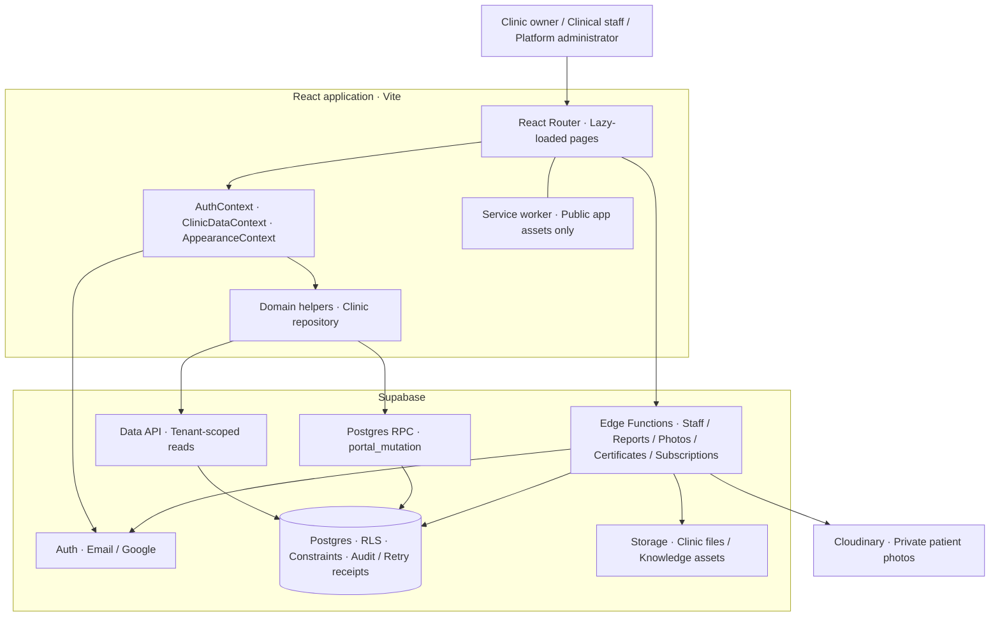

<div align="center">
  
  <h1>Veterina</h1>
  <p><strong>Every patient. Every visit. One connected clinic.</strong></p>
  <p>A veterinary clinic workspace for patient records, daily care, scheduling, and inventory.</p>
  <p>
    
    
    
    
  </p>
  <p>
    <a href="#overview">Overview</a> &middot;
    <a href="#architecture">Architecture</a> &middot;
    <a href="#getting-started">Getting started</a> &middot;
    <a href="#testing">Testing</a> &middot;
    <a href="#documentation">Documentation</a>
  </p>
</div>

---

## Overview

Veterina brings the clinic's daily work into a shared, installable web app. Owners and approved clinical staff can follow a patient from registration and arrival through treatment, prescriptions, preventive care, and follow-up.

The system supports multiple clinics with separate records, staff access, branding, and subscriptions. Clinic pages load saved database records; empty clinics show empty states without demo-data fallbacks.

### What you can do

| Workspace | Capabilities |
| --- | --- |
| **Daily operations** | Compact shift dashboard, live clinic floor, unfinished charts and drafts, inline follow-up completion, clinical stock watch and batch expiry alerts, appointment stream, recent patients and quick walk-in intake. |
| **Patients and owners** | Searchable directories, registration, optional private photos, alerts, growth and vitals, and a unified clinical timeline. |
| **Global search** | Header search across saved clinical, scheduling, inventory and document records; grouped suggestions, bounded results and focused record links, scoped to the current clinic and role. |
| **Clinical care** | Checkups, clinical notes, laboratory requests and results, diagnoses, follow-up plans, finalization, retained corrections, and service records. |
| **Admissions** | Hospitalization dashboard, wards/cages/kennels, transfers, monitoring, scheduled treatments, medication administration, historical stays, and durable discharge summaries. |
| **Owner admission tracking** | No-login tracking with a private 13-character code or QR card, clinic-approved public fields and updates, credential rotation/revocation, and expiry. |
| **Preventive care** | Grouped vaccination records, individual deworming administrations, next-dose reminders, historical records, and inventory-linked completion. |
| **Scheduling** | Appointments, veterinarian conflict checks, patient arrival, follow-up scheduling, and reminder activity. |
| **Prescriptions and stock** | Batch-based dispensing, stock movements, expiry tracking, supplier management, and prescription PDF/PNG exports. |
| **Documents and reporting** | Printable patient histories, filtered CSV exports, and travel certificates with public verification. |
| **Clinic administration** | Staff approval, services, clinic and veterinarian details, branding, six clinic palettes, and Light/Dark/System appearance. |
| **Platform administration** | Clinic subscriptions, activation codes, extensions, and subscription history. |

### Care that stays connected

Operational care follows **Waiting → In progress → Completed**, with cancellation available. Drafts preserve work without completing care. Historical record entry is separate and creates no queue entry, live reminder, or stock deduction.

Hospitalization uses **Admitted → Under Treatment → Ready for Discharge → Discharged**, independently of clinical condition. Approved staff manage care and authorize discharge; owners configure facilities, cancel intake-only mistakes, and append corrections. Accommodation can remain unassigned. Released cages require cleaning. Inpatient medication orders do not consume stock: each recorded Given dose deducts its selected batch once. Existing outpatient prescriptions continue deducting when saved.

Public admission tracking is available at `/track-admission`. Staff approve fields and generate a bearer-secret code in an admission's **Public tracking** tab. The default view contains the workflow status and published updates. Staff can separately enable **Live clinical sharing** to expose Admission activity, Monitoring & notes, and Care board, including existing/future clinical notes, measurements, medication doses and staff names. Existing links stay limited until this approval; their codes remain unchanged. Codes expire after 90 days or 7 days after discharge, whichever comes first. The KAN-22 backend, including clinical sharing, is deployed to the configured `Veterina_Demo` project as of 9 November 2026. The frontend runs locally; future Vercel hosting requires SPA rewrites and equivalent privacy/cache headers. See [the policy and rollout notes](docs/kan-22-admission-tracking.md).

The admissions migrations and follow-up foreign-key indexes are applied to the hosted Development project (`yerrtkosxksacqxznrhk`) as of 8 November 2026. Apply the matching backend migrations before releasing this frontend to another environment. See [admissions testing and rollout](TESTING.md#patient-admission-and-hospitalization-kan-19).

Vaccination records can contain multiple vaccines; deworming records contain one administration. Clinical dose and stock quantity are separate. Waiting entries and drafts do not consume inventory; completion deducts stock atomically. Consumed product, batch, and quantity details remain locked to preserve stock history.

## Architecture

Veterina is a React single-page application backed by Supabase. The browser handles presentation and workflow state; Postgres and authenticated Edge Functions enforce access and perform server-side operations.



### How data moves

1. **Authenticate:** Supabase Auth establishes the session. Workspace access also checks the active staff profile, clinic membership, and subscription.
2. **Read:** `ClinicDataContext` loads records through `clinicRepository`, which normalizes database rows for the UI. Database policies restrict access to the caller's clinic.
3. **Write:** Core clinical changes use `portal_mutation` with an action, payload, and retry key. Database transactions enforce workflow rules and protect related record, reminder, and stock updates.
4. **Refresh:** After a successful mutation, the context reloads saved data. Failed refreshes offer recovery without silently presenting the save as undone.
5. **Run specialized operations:** Edge Functions handle staff administration, exports, subscriptions, private photos, and travel certificates, with explicit authentication and authorization.

Header search uses a private Postgres index and authenticated search/detail RPCs.
The search routes load only clinic settings, the current profile and bounded
results; clinical workspaces retain their existing loader. The KAN-23 backend is
deployed to the configured `Veterina_Demo` project as of 9 November 2026. Apply its
migration when releasing to another environment. See [search coverage, privacy,
verification and rollout](docs/kan-23-global-search.md).

### Access model

| Role | Responsibility |
| --- | --- |
| **Clinical staff** | Approved access to patient care, queues, appointments, prescriptions, and inventory workflows. |
| **Clinic owner** | Clinical workspace access plus clinic administration, staff approvals, reports, and permitted permanent deletions. |
| **Platform administrator** | Separate platform access for clinic subscriptions and activation codes; clinic ownership does not grant this role. |

New owners activate their own clinic with a subscription activation code. Staff join an existing clinic using its **Veterina Code** and wait for owner approval. These are separate codes with separate purposes.

### PWA behavior

The app supports installation, update prompts, and offline status messaging. The service worker caches public build assets. Clinic records, authentication requests, mutations, and private patient photos are not cached by the service worker. Loading or saving clinic data requires an internet connection.

### Technology

| Layer | Tools |
| --- | --- |
| UI | React 19, React Router 7, Phosphor icons, Recharts, DayPicker, date-fns |
| Styling | CSS custom properties, component styles, Tailwind CSS 4 |
| Build and installation | Vite 8, `vite-plugin-pwa`, Workbox |
| Backend | Supabase Auth, Postgres, Storage, and TypeScript Edge Functions |
| Private photo delivery | Cloudinary through authenticated Edge Functions |
| Verification | Vitest, Playwright with Chrome, Oxlint, SQL and concurrency suites |

## Getting started

### Prerequisites

- Node.js **22.12+** and npm, or another Node version supported by Vite 8.
- Access to a Supabase project with Veterina's matching schema and Edge Functions deployed.
- An approved clinic account, or the credentials and codes needed to complete registration.

### Run locally

```sh
npm ci
```

Copy `.env.example` to `.env.local`, then set the browser configuration:

```dotenv
VITE_SUPABASE_URL=https://your-project.supabase.co
VITE_SUPABASE_PUBLISHABLE_KEY=your-publishable-key
```

```sh
npm run dev
```

Open the local URL printed by Vite, normally `http://localhost:5173`. Restart the dev server after changing environment variables.

`VITE_SUPABASE_ANON_KEY` remains a compatibility fallback. Use only the publishable key or legacy anon key in frontend configuration. Service-role keys, provider secrets, and worker credentials belong on the server.

### Accounts

- **Owner:** Register at `/create-account`, complete any required email verification, redeem an activation code, and personalize the clinic.
- **Staff:** Register with the clinic's Veterina Code, complete any required email verification, and wait for owner approval.
- **Existing account:** Sign in at `/sign-in` using email/password or configured Google authentication.
- **Platform administrator:** Use `/admin/sign-in`; administrator access must be provisioned separately.

Email delivery and Google sign-in depend on the target project's Auth configuration. Configure callback and recovery URLs for each deployed origin.

### Build and deployment

```sh
npm run build
npm run preview
```

The production build is written to `dist/`. Serve it over HTTPS with SPA fallback to `index.html` so direct links such as `/patients/:petId` work. Configure the same public environment variables before building, and set server-side secrets using [the Edge Function environment template](supabase/functions/.env.example).

Frontend and backend releases must use matching migrations and Edge Functions. The current theme and preventive-care features depend on:

- `20261107025039_clinic_appearance_theme.sql`
- `20261107043221_preventive_care_records.sql`
- `20261107043602_preventive_care_explicit_grants.sql`
- `20261107043603_preventive_care_service_role_read.sql`

These are additions to the existing backend, not a complete bootstrap sequence. The early `001`–`008` migrations describe a historical snapshot and must not be replayed over an existing deployment. Follow [the isolated database setup](TESTING.md#isolated-database-setup) when preparing a separate environment.

## Project structure

```text
Veterina/
├── public/                  # Brand assets, icons, and public files
├── src/
│   ├── App.jsx              # Routes and lazy-loaded pages
│   ├── main.jsx             # Application entry and global providers
│   ├── pages/               # Clinic, account, public, and admin screens
│   ├── components/          # UI, record editors, cards, and workflow dialogs
│   ├── context/             # Authentication, clinic data, and appearance
│   ├── lib/                 # Data access, domain helpers, and unit tests
│   ├── utils/               # Shared clinic rules and utilities
│   ├── index.css            # Global styles
│   └── appearance.css       # Light and dark theme tokens
├── supabase/
│   ├── functions/           # Edge Functions and shared server helpers
│   ├── migrations/          # Database schema and workflow changes
│   └── tests/               # SQL workflow and security checks
├── scripts/                 # Browser acceptance, integration, and tooling
├── docs/                    # Design and historical deployment references
└── TESTING.md               # Test setup, coverage, and verification limits
```

## Testing

| Command | Purpose |
| --- | --- |
| `npm test` | Unit tests for domain logic and shared server helpers. |
| `npm run lint` | Static checks with Oxlint. |
| `npm run build` | Production compilation and PWA generation. |
| `npm run test:preventive-care` | Browser acceptance for grouped vaccines, deworming, drafts, filters, calendar views, and responsive layouts. |
| `npm run test:theme` | Appearance modes, clinic palettes, persistence, permissions, and accessibility checks. |
| `npm run test:pwa` | Installability, service worker, caching, and update behavior checks. |
| `npm run test:database` | Real persistence checks against an isolated local backend. |
| `npm run test:all` | Aggregate unit, build, browser, API, and database checks. |

Browser suites use installed Chrome. Database suites need additional local services, credentials, and tools; follow [TESTING.md](TESTING.md) before running them. Some suites contact configured APIs. Aggregate reports and screenshots are written to ignored `test-artifacts.local/`.

Intercepted browser tests verify UI behavior separately from database persistence. Interactive OAuth, recovery-email delivery, physical-device installation, hosted infrastructure, and production load require their own acceptance checks.

## Documentation

| Reference | Contents |
| --- | --- |
| [Testing and verification](TESTING.md) | Feature coverage, isolated backend setup, deployment prerequisites, and acceptance limits. |
| [Daily workflows](DAILY-WORKFLOW-PLAN.md) | Daily action board, stock watch, and connected patient history. |
| [Clinic access and staff onboarding](docs/veterina-code-rbac-plan.md) | Veterina Code, clinic isolation, roles, and staff approval design. |
| [Backend requirements](PRD.md) | Backend requirements and planned release gates. |
| [Frontend requirements](PRD.frontend.md) | Original frontend requirements and product context. |
| [Historical setup notes](docs/legacy-setup-notes.md) | Preserved deployment instructions and environment observations from the previous README. |

Knowledge and assistant implementation remains in the repository, but the Knowledge workspace route is currently paused. Product requirements and historical notes may describe planned or earlier behavior; use the current routes, source, and verification guide to establish what is available.
